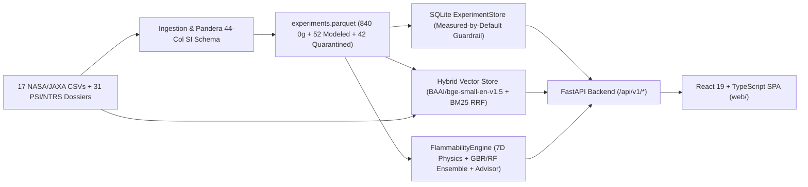

# 🔥 Flame in Freefall (IGNIS)
**SI-Powered Fire Safety Insights from NASA/JAXA Microgravity Combustion Data**  
*2026 NASA Space Apps Challenge*

Video Demo : https://www.youtube.com/watch?v=Ej8UTyzgnrQ
Live Demo (minimal): https://flame-in-freefall-jim1.onrender.com


An interactive **React 19 + TypeScript + Vite** decision-support application (with a companion **Streamlit** dashboard) and **grounded Multi-Document + Tabular Hybrid RAG + Physics-Informed ML engine** that unifies decades of NASA and JAXA microgravity combustion experiments (**892 experiments × 44 columns** across **30 dataset families** and **35 investigations**, plus **31 official NASA PSI Investigation Dossiers & NTRS Technical Reports**) to deliver deterministic, citation-verified fire-safety insights and exportable mission certification dossiers for ISS, Artemis lunar habitats, and Mars transit missions.

---

## ✨ Key Capabilities

1. **Modern React 19 + TypeScript + Vite SPA with 60 FPS Animated Flame Canvas (`web/`):**
   - **Real-Time Combustion Canvas & Aerospace UI (`web/src/components/FlameBackground.tsx`, `web/src/pages/SiteNav.tsx`):** Floating pill navigation (`01 Overview`, `02 Explorer`, `03 Physics Lab`, `04 Risk Simulator`, `05 Analytics`, `Ask IGNIS`) with a dark/light theme toggle over a full-viewport 60 FPS HTML5 `<canvas>` rendering turbulent bottom-horizon flame plumes, an interactive cursor-parallax **$0g$ spherical blue/cyan microgravity diffusion flame orb**, and drifting amber/cyan embers.
   - **6 Interactive Modules:**
     - `#/` **01 Overview (`Home.tsx`):** Animated telemetry KPI strip (`StatStrip`), interactive **1g vs. 0g Gravity Regime Comparator** (buoyant teardrop plume vs. spherical diffusion & oxygen-starved quenching), 4-stage architecture pipeline, **6 clickable measured NASA PSI sample cards** (opening the 44-column `DetailDrawer`), and Scientific Trust Guardrails.
     - `#/explorer` **02 Explorer (`Explorer.tsx`):** Filter across 30 dataset families, search across IDs/fuels/notes/outcomes, opt-in `Include 52 Modeled Partial-g Rows (is_modeled=True)`, inspect the live **Fixed vs. Varied Experimental Variables & Sensors Summary**, and open any experiment's 44-column slide-over provenance drawer.
     - `#/insights` **03 Physics Lab (`Insights.tsx`):** 5 interactive tabs covering **Top 5 Ranked Findings**, **Historical Spacecraft Incidents (4)** (**Apollo 1**, **Apollo 13**, **1997 Mir Space Station Vika/TGK fire**, **ISS-to-Artemis SEA transition**), **Family Criticality Ranking (30)**, **Investigation Objectives & Comparator (24)** (side-by-side PSI study comparator with 4 quick NASA presets such as `SAME vs. DAFT` and `ACME-BRE vs. BASS-II`, plus searchable 24-investigation objectives cards), and **Live NASA PSI Tables & Dossiers** (`PSI-10`, `PSI-22`, `PSI-26` CSVs).
     - `#/simulator` **04 Risk Simulator (`Simulator.tsx`):**
       - **6 Mission Atmosphere Presets & Expanded Controls:** One-click presets for **ISS Standard** (`21% O₂, 101.3 kPa`), **Artemis Lunar Habitat** (`34% O₂, 56.5 kPa`), **Lunar Interim** (`30% O₂, 70.3 kPa / 10.2 psi`), **EVA Spacesuit** (`100% O₂, 29.6 kPa / 4.3 psi`), **ACME CFI-G Extreme** (`85% O₂, 101.3 kPa`), and **Fans Off / Quiescent** (`21% O₂, 0 cm/s`), paired with `12%–100% O₂`, `20–120 kPa` (with live `psi`), `0–55 cm/s` airflow sliders, and 13 canonical materials.
       - **7-Feature Coupled Physics + Ensemble ML Engine:** Evaluates $\text{O}_2\%$, Cabin Pressure ($\text{kPa}$), HVAC Airflow ($\text{cm/s}$), Material Hazard, **Oxygen Partial Pressure ($P_{\text{O}_2}$)**, **Inert Diluent Heat-Sink Ratio ($\text{N}_2/\text{O}_2$)**, and **Microgravity Peclet Transport Factor ($\text{Pe}_{\text{eff}}$)** with **90% Ensemble Prediction Intervals (`[p10, p90]`)** and **Epistemic Confidence (`HIGH` / `MODERATE` / `EXPLORATORY`)**.
       - **Interactive 2D Contour Maps:** Click-to-set HTML5 `<canvas>` contour maps for the **2D Pressure × $\text{O}_2\%$ Flammability Envelope** (comparing **$0g$ Microgravity MOC** vs. **$1g$ `NASA-STD-6001` MOC**, with `[map edge 45%]` indicator for >45% $\text{O}_2$ EVA/CFI-G states) and the **2D Airflow × $\text{O}_2\%$ Quenching & Blowoff Regime Map** (diffusive self-extinguishment $< 1.5\text{ cm/s}$ and high-flow blowoff $> 32\text{ cm/s}$).
       - **🚨 Spacecraft Fire Detection, Suppression & Post-Fire Cleanup Advisor (`SAME`, `DAFT / DAFT-2`, `SLICE`, `SAFFIRE IV–VI`, `MGM`):** Recommends optimal smoke detector modality (Laser Photoelectric Scattering vs. Americium-241 Ionization based on $0g$ vs. $1g$ smoke Count Median Diameter $\mu\text{m}$), `DAFT-2` Lunar Regolith Dust ($M_1/M_0$ moment ratio) false-alarm mitigation, a 4-modality `SLICE` fire suppressant matrix (`Fine Water Mist`, `CO₂ Flood`, `N₂ Dilution`, `Halon Replacement CF₃I`), peak $\text{CO}$ ppm vs. NASA 1-hr/24-hr SMAC (`55 ppm` / `20 ppm`), toxic pyrolysis gases ($\text{HCN}$, $\text{HF}/\text{COF}_2$, $\text{SiO}_2$ ash), and a 4-step `SAFFIRE-VI` post-fire ECLSS scrubbing protocol.
       - **📜 Exportable Mission Fire-Safety Dossier (`.md` & Print-Ready A4 PDF Certificate):** Generates an auditable certification report with a deterministic ID (`IGNIS-CERT-...`), `experiments.parquet` SHA-256 fingerprint, formal `PASS` / `CONDITIONAL PASS` / `WAIVER REQUIRED` determination, and an embedded vector SVG 2D MOC Boundary Chart.
     - `#/dashboard` **05 Analytics (`Dashboard.tsx`):** Visualizes corpus coverage KPIs, Earth/Moon/Spacesuit $\text{O}_2$ & pressure context bars, NASA investigation hardware groupings (`ACME`, `FLEX/CFI`, `BASS`, `SPICE/SLICE`, `Saffire`, `SAME/DAFT`), and explicit dataset guardrails.
     - `#/ask` **Ask IGNIS (`App.tsx`):** Grounded Multi-Doc + Tabular Hybrid RAG Q&A with clickable `[ID]` citation chips, `QueryPlan` inspector, sortable evidence table, **📚 Grounded NASA PSI Dossiers & NTRS Literature Context** cards, and a live **65/65 (100.0%) Golden Benchmark Scorecard** tab.

2. **Deterministic Ingestion & Provenance Auditing (`src/flame/ingestion/`):**
   - Consolidates 17 NASA/JAXA source CSV datasets (`BASS`, `BASS-II`, `SOFIE`, `SAFFIRE I–VI`, `FLEX`, `FLEX-2`, `ACME` suite, `SLICE`, `MGM`, `SAME`, `SPICE`, `DAFT`, `FLARE`, `GRC Drop Tower`, and `NASA-STD-6001`) plus live NASA Physical Sciences Informatics (**PSI**) metadata (`data/raw/psi/`) into a validated Parquet snapshot (`data/processed/experiments.parquet`).
   - Enforces explicit provenance tracking (`source_file`, `source_row`, `record_source`), quarantines 42 corrupt BASS-II airflow readings (`> 1000 cm/s` → `AIRFLOW_QUARANTINED`), and isolates 52 computational partial-gravity bounding rows (`is_modeled = True`) so they are excluded by default unless explicitly toggled.

3. **Multi-Document Literature + Tabular Neural/Lexical Hybrid RRF & Deterministic SQL Retrieval (`src/flame/retrieval/`):**
   - Compiles natural-language questions into typed, schema-whitelisted `QueryPlan` objects executed against an in-memory SQL engine (DuckDB / SQLite-over-Parquet) with exact `n_used`, `n_null_excluded`, and `n_quarantined_excluded` accounting.
   - Encodes all **892 experiment records** (`local_hybrid_index.joblib`) and **31 NASA PSI Investigation Dossiers + NTRS Technical Reports** (`literature_hybrid_index.joblib`, via `LiteratureRetriever` in `src/flame/retrieval/literature.py`) using **`SentenceTransformer("BAAI/bge-small-en-v1.5")`** (384-dimensional L2-normalized dense neural embeddings with `local_files_only=True` at query time) fused with **Okapi BM25** lexical search and active `dataset_family` boosting via **Reciprocal Rank Fusion (RRF, $k=60$)** — achieving **100.0% Recall@10** on qualitative benchmark queries.

4. **Grounded RAG with Post-Generation Guardrails & 65/65 Golden Benchmark (`src/flame/rag/`, `evaluation/`):**
   - Verifies every inline citation (`[BASS-B1]`, `[SOFIE-001]`, `[FLEX2-F2-05]`, etc.) against retrieved evidence rows, pairs tabular evidence with grounded NASA PSI/NTRS literature passages, checks numeric grounding within $10^{-4}$ relative tolerance, enforces modeled-row disclosures, and warns on semantically incomparable cross-family aggregations (`burning_rate_mms`).
   - Works **100% offline** via `LocalHeuristicLLMClient` and passes **65/65 (100.0%)** golden benchmark questions in `evaluation/run_eval.py` across Single-Filter, Multi-Filter, Aggregation, Ranking, Qualitative Hybrid RRF, Guardrail Refusal, and Adversarial Injection categories.

---

## 🗺️ Website Sections & System Architecture

### What Each Website Section Does (`SiteNav` Routes)

| Nav Label | Hash Route | Component | Core Purpose & Interactive Features |
| :--- | :--- | :--- | :--- |
| **01 Overview** | `#/` | `Home.tsx` | Mission control landing page featuring the animated $0g$ flame orb HUD, live telemetry KPIs (`StatStrip`), **1g vs. 0g Gravity Regime Comparator**, 4-stage pipeline summary, **6 clickable measured NASA PSI telemetry cards** (`DetailDrawer`), and trust guardrails. |
| **02 Explorer** | `#/explorer` | `Explorer.tsx` | Full **892-row dataset browser** across 30 families with free-text search, opt-in `Include 52 Modeled Partial-g Rows`, **Fixed vs. Varied Experimental Variables & Sensors Summary** (`summarizeVariables`), quality flags, and 44-column slide-over `DetailDrawer`. |
| **03 Physics Lab** | `#/insights` | `Insights.tsx` | 5-tab synthesis workspace: **Top 5 Ranked Findings**, **Historical Spacecraft Incidents (4)**, **Family Criticality Ranking (30)**, **Investigation Objectives & Comparator (24)** (side-by-side PSI study comparator + 4 quick NASA presets + searchable objectives), and **Live NASA PSI Tables & Dossiers**. |
| **04 Risk Simulator** | `#/simulator` | `Simulator.tsx` | Spacecraft & lunar habitat flammability engine with **6 presets** (`ISS`, `Artemis SEA`, `Lunar Interim 30%`, `EVA 100%`, `ACME CFI-G 85%`, `Fans Off`), **`12%–100% O₂`** / **`20–120 kPa (psi)`** / **`0–55 cm/s`** controls, 13 materials, **90% ensemble CI**, **7D Physics Diagnostics**, **2 click-to-set 2D MOC & Airflow `<canvas>` maps**, **Detection/Suppression Advisor**, 5-NN NASA matches, and `.md` / Print PDF Dossier export. |
| **05 Analytics** | `#/dashboard` | `Dashboard.tsx` | Corpus audit dashboard displaying KPI totals (`StatStrip`), Earth/Moon/Spacesuit $\text{O}_2$ & pressure context bars, **6-group NASA Investigation Hardware Map** (`ACME`, `FLEX/CFI`, `BASS`, `SPICE/SLICE`, `Saffire`, `SAME/DAFT`), and dataset limitation rules. |
| **Ask IGNIS** | `#/ask` | `App.tsx` | Grounded AI analyst with two tabs: **Grounded Q&A** (question bar, `ModeledToggle`, `LimitationsBanner`, clickable `[exp_id]` citation chips, `QueryPlan` inspector, sortable `EvidenceTable`, top-4 `LiteratureRetriever` NASA PSI/NTRS cards) and **65-Question Golden Benchmark Scorecard**. |

### Website Navigation & Feature Flowchart

```mermaid
flowchart TD
    NAV["SiteNav Pill Bar (Theme Toggle + FlameBackground Canvas)"]
    NAV --> R1["01 Overview (#/)"]
    NAV --> R2["02 Explorer (#/explorer)"]
    NAV --> R3["03 Physics Lab (#/insights)"]
    NAV --> R4["04 Risk Simulator (#/simulator)"]
    NAV --> R5["05 Analytics (#/dashboard)"]
    NAV --> R6["Ask IGNIS (#/ask)"]

    R1 --> R1A["1g vs 0g Regime Comparator + Live KPI Strip"]
    R1 --> R1B["6 Clickable Measured PSI Samples -> DetailDrawer"]

    R2 --> R2A["30-Family Filter + Search + Modeled Toggle"]
    R2 --> R2B["Fixed vs Varied Variables & Sensors Matrix"]
    R2 --> R2C["Sortable 892-Row Table -> 44-Column DetailDrawer"]

    R3 --> R3A["Top 5 Ranked Findings + 4 Spacecraft Incidents"]
    R3 --> R3B["30 Family Rankings + Live PSI CSV Tables"]
    R3 --> R3C["24-Study Objectives & Side-by-Side Comparator"]

    R4 --> R4A["6 Presets + 12-100% O2 / 20-120 kPa / 13 Materials"]
    R4 --> R4B["7D Physics Diagnostics + 90% Ensemble CI"]
    R4 --> R4C["Click-to-Set 2D MOC & Airflow Quench Maps"]
    R4 --> R4D["SAME/DAFT/SLICE/SAFFIRE Advisor + PDF/MD Dossier"]

    R5 --> R5A["Earth / Moon 30% / EVA 100% Context Bars"]
    R5 --> R5B["6 NASA Hardware Rigs + Data Guardrail Caveats"]

    R6 --> R6A["Hybrid SQL + BGE/BM25 RAG with [ID] Citation Chips"]
    R6 --> R6B["65-Question Golden Benchmark Scorecard"]
```



### End-to-End Backend Data, RAG & Physics Pipeline



---

## 📁 Project Structure

```text
NSAP/
├── src/flame/                      # Core Flame in Freefall Python engine
│   ├── config.py                   # Typed FLAME_* settings (pydantic-settings)
│   ├── schemas/                    # Experiment (44 cols), QueryPlan, AskResponse contracts
│   ├── ingestion/                  # CSV canonicalization, cleaning, Pandera/hard validation
│   ├── retrieval/                  # ExperimentStore (SQL), compiler, catalog, BGE + BM25 RRF search
│   ├── rag/                        # QueryPlanner, AnswerGenerator, citation/numeric guardrails
│   ├── llm/                        # LocalHeuristicLLMClient, OpenAICompatClient (Ollama), Anthropic
│   ├── observability/              # Request-ID correlation & secret-redacting structured logs
│   └── api/                        # FastAPI routes (/api/v1/*), FlammabilityEngine & SPA mount
├── backend/app/
│   ├── main.py                     # ASGI entrypoint mounting flame.api (:8000)
│   └── core/http.py                # Verified TLS/SSL session helper for NASA PSI & Space Apps
├── web/                            # React 19 + TypeScript + Vite SPA (:5173 / mounted on :8000)
│   ├── src/
│   │   ├── components/
│   │   │   ├── FlameBackground.tsx # 60 FPS HTML5 Canvas flame plumes + 0g blue microgravity orb
│   │   │   ├── AnswerPanel.tsx     # Grounded Markdown + interactive [ID] citation chips
│   │   │   ├── EvidenceTable.tsx   # Sortable evidence table with provenance flags
│   │   │   └── DetailDrawer.tsx    # Slide-over 44-column provenance & audit drawer
│   │   ├── pages/
│   │   │   ├── SiteNav.tsx         # Floating pill nav (01 Overview..05 Analytics, Ask IGNIS) & theme toggle
│   │   │   ├── Home.tsx            # 01 Overview: 0g orb HUD, KPIs, 1g vs 0g comparator & clickable samples
│   │   │   ├── Explorer.tsx        # 02 Explorer: 892-row browser, Variable Matrix & 44-col DetailDrawer
│   │   │   ├── Insights.tsx        # 03 Physics Lab: 5 tabs incl. 24-study Objectives & Comparator
│   │   │   ├── Simulator.tsx       # 04 Risk Simulator: 12-100% O2, 2D MOC canvas, Advisor & Dossier Export
│   │   │   └── Dashboard.tsx       # 05 Analytics: O2/pressure context bars, hardware map & data guardrails
│   │   ├── lib/                    # Citation parser, remark plugin, sorting & example questions
│   │   └── App.tsx                 # Ask IGNIS: Grounded Multi-Doc Hybrid RAG Q&A + 65/65 Benchmark Scorecard
│   └── tests/                      # 38 Vitest + Testing Library unit & integration tests
├── frontend/                       # Companion Streamlit interactive dashboard (:8501)
│   ├── app.py                      # Mission Control Home (KPIs, caveats, atmosphere envelope)
│   ├── pages/
│   │   ├── 1_Explorer.py           # Dataset & 44-column provenance browser + Modeled toggle
│   │   ├── 2_Insights.py           # Top 5 ranked safety findings, historical incidents & PSI CSVs
│   │   ├── 3_Risk_Simulator.py     # 2D MOC maps, Detection/Suppression Advisor & Dossier Export
│   │   └── 4_Ask_the_Data.py       # Grounded Multi-Doc Hybrid RAG + 65/65 Benchmark Scorecard
│   └── components/                 # theme.py (animated flame theme), api_client.py, charts.py
├── data/
│   ├── raw/                        # 17 NASA/JAXA source CSVs + live PSI JSON/CSV catalog
│   ├── processed/                  # experiments.parquet (892×44), canonical_experiments.csv, manifest
│   ├── reports/                    # quality_report.md, canonical_diff.csv
│   └── interim/qdrant/             # Local BGE-small-en-v1.5 (384-d) + BM25 hybrid indexes (892 rows + 31 lit docs)
├── evaluation/
│   ├── golden_questions.yaml       # 65 hand-verified benchmark questions & QueryPlans
│   ├── expected_answers.yaml       # Deterministic expected answers & citations
│   ├── run_eval.py                 # Benchmark evaluation harness (65/65 = 100.0% pass rate)
│   └── results/                    # latest_scorecard.json & latest_scorecard.md
├── scripts/
│   ├── build_dataset.py            # Rebuilds experiments.parquet & quality_report.md from data/raw/
│   ├── build_index.py              # Encodes 892 rows + 31 PSI/NTRS lit docs with BGE-small-en-v1.5 + BM25
│   ├── fetch_psi_data.py           # Pulls live combustion investigations & CSVs from psi.nasa.gov
│   └── run_local.sh                # Launches FastAPI (:8000) + React Vite (:5173) or Streamlit (:8501)
├── certs/                          # Intermediate CA certificate for strict TLS verification
├── docs/                           # data_dictionary.md, architecture.md, audit & ADRs
├── tests/                          # 174 Python unit & API integration tests (pytest)
├── explanation.md                  # End-to-end architecture, physics, UI & benchmark walkthrough
└── requirements.txt
```

---

## 🚀 Quickstart (Localhost)

### 1. Activate Virtual Environment
The project uses a Python 3.12 virtual environment in `.venv`:
```bash
source .venv/bin/activate
```

### 2. Rebuild Dataset Snapshot, Hybrid BGE Index & Benchmark Scorecard (Optional — Pre-built)
```bash
PYTHONPATH=src:. python scripts/build_dataset.py
PYTHONPATH=src:. python scripts/build_index.py
PYTHONPATH=src:. python evaluation/run_eval.py
```

### 3. Run the React UI & FastAPI Backend

- **Option A — Hot-Reload Dev Mode (FastAPI `:8000` + React Vite `:5173`):**
  ```bash
  bash scripts/run_local.sh
  ```
- **Option B — Unified Single-Port Production Server (FastAPI serving `web/dist` on `:8000`):**
  ```bash
  npm run build --prefix web
  PYTHONPATH=src:. .venv/bin/uvicorn backend.app.main:app --port 8000
  ```
- **Option C — Companion Streamlit Dashboard (`:8501`):**
  ```bash
  bash scripts/run_local.sh --streamlit
  ```

| Interface | URL |
|:--|:--|
| **React 19 + Vite UI (Dev)** | http://localhost:5173 |
| **Unified FastAPI + React SPA (Prod)** | http://localhost:8000 |
| **FastAPI OpenAPI Docs** | http://localhost:8000/docs |
| **Streamlit Dashboard** | http://localhost:8501 |

---

## 🔌 API Endpoints (`/api/v1`)

| Method | Endpoint | Description |
|:--|:--|:--|
| `GET` | `/api/v1/health` | Liveness probe (`{"status": "ok"}`) |
| `GET` | `/api/v1/ready` | Readiness probe verifying `experiments.parquet`, provenance manifest, and row count (`892`) |
| `GET` | `/api/v1/meta` | Dataset version, 44-field catalog, 30 dataset families, modeled count (`52`), and scientific caveats |
| `GET` | `/api/v1/experiments` | Filtered & paginated experiments (`dataset_family`, `fuel_material`, `include_modeled`, `limit`, `offset`) |
| `GET` | `/api/v1/experiments/{id}` | Single experiment record with all 44 canonical, enrichment, and provenance columns |
| `GET` | `/api/v1/insights/ranking` | Top 5 ranked spacecraft fire-safety insights, 4 historical incidents, 30 family rankings, and live PSI CSV tables |
| `POST` | `/api/v1/insights/risk` | Physics-informed ML flammability risk score, 90% CI bounds, 2D MOC & airflow envelopes (`19×19`), `SAME`/`DAFT`/`SLICE`/`SAFFIRE` Detection & Suppression Advisor, and 5 closest historical experiments |
| `POST` | `/api/v1/insights/dossier` | Generates an exportable NASA-style Mission Fire-Safety Certification Dossier (`markdown_report` `.md` + `html_printable` A4 PDF certificate with embedded SVG 2D MOC curve) |
| `GET` | `/api/v1/literature` | Searches or lists the 31-document NASA PSI Investigation Dossiers & NTRS combustion literature corpus using BGE + BM25 Hybrid RRF |
| `POST` | `/api/v1/ask` | End-to-end grounded RAG (`plan -> retrieve -> generate -> guardrails`) returning answer, citations, `QueryPlan`, aggregates, evidence rows, and multi-document `literature` passages |
| `GET` | `/api/v1/evaluation` | Latest 65-question golden benchmark scorecard (`65/65 = 100.0%` pass rate, `100.0%` Hybrid RRF Recall@10) |
| `POST` | `/api/v1/evaluation/run` | Executes all 65 golden benchmark questions live and returns the updated scorecard |

---

## 🧪 Running Tests & Evaluation

Run the full Python backend test suite (**174 passed, 1 skipped**), the React frontend test suite (**38 passed** across 5 files), and the 65-question golden benchmark (**65/65 = 100.0%**):
```bash
PYTHONPATH=src:. .venv/bin/pytest -q tests/
npm test --prefix web
PYTHONPATH=src:. .venv/bin/python evaluation/run_eval.py
PYTHONPATH=src:. .venv/bin/uvicorn backend.app.main:app --host 0.0.0.0 --port 8000 --reload
```

---

## 🤖 Optional LLM Configuration (`.env`)

By default, `/api/v1/ask` uses `LocalHeuristicLLMClient`, which runs 100% offline without an API key. To connect a live local **Ollama** model or cloud LLM, set the following in `.env`:

```ini
FLAME_LLM_PROVIDER=openai_compat
FLAME_LLM_MODEL=llama3.1
FLAME_LLM_BASE_URL=http://localhost:11434/v1
FLAME_LLM_API_KEY=local
```
