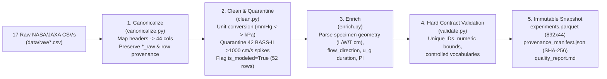

# 🔥 Flame in Freefall (IGNIS) — Complete Judge & Engineering Walkthrough
**2026 NASA Space Apps Challenge — "Flame in Freefall: SI-Powered Fire Safety Insights from Microgravity Combustion Data"**

This document provides a complete, end-to-end explanation of **Flame in Freefall (IGNIS)**: our capabilities, scientific findings, technology stack, raw and processed datasets, data-cleaning and validation pipeline, machine-learning and retrieval algorithms, UI screen-by-screen walkthrough, and verification benchmarks.

---

## 1. Executive Summary & Problem Statement Alignment

### 1.1 Why Fire in Microgravity ($\mu g$) Is Fundamentally Different from Earth ($1g$)
On Earth ($1g$), buoyancy drives hot combustion gases upward ($\sim 50\text{--}100\ \text{cm/s}$), drawing fresh oxygen into the base of a tear-drop flame but also cooling the flame zone via convective heat loss. In **microgravity ($0g$)** aboard the International Space Station (ISS), Orion, Gateway, or future Mars transit habitats:
1. **Buoyancy Vanishes:** Flames become spherical (`FLEX`, `ACME`) and rely entirely on molecular diffusion and slow cabin HVAC ventilation (`1.5–25 cm/s`) for oxygen transport.
2. **1g Ground Screening (`NASA-STD-6001` Test 1) Can Under-Predict $0g$ Hazard:** In low-velocity microgravity flows (`1.5–20 cm/s`), the absence of buoyant convective cooling reduces heat loss, allowing materials like thin **PMMA**, **SIBAL fabric**, **Silicone membranes**, and **Nomex/Velcro** to sustain combustion at **Minimum Oxygen Concentrations (MOC) $2.5\%\text{--}3.5\%\ \text{O}_2$ lower** than in $1g$ upward screening (`BASS-II`, `SOFIE`, `SAFFIRE`).
3. **Artemis Exploration Atmospheres Amplify Risk:** Future lunar habitats and EVA pre-breathe protocols operate at **Hypobaric Hyperoxic Space Exploration Atmospheres (`34% O₂, 56.5 kPa / 8.2 psia`)**. Reduced nitrogen partial pressure removes the inert $\text{N}_2$ thermal heat sink, accelerating flame spread rates by **$1.8\times\text{--}2.9\times$** (`SAFFIRE IV–VI`, `SOFIE`).
4. **Cool Flames & Invisible Re-Ignition:** Droplets of heptane and decane extinguish visibly via radiative heat loss only to transition into **low-temperature cool flames ($\sim 650\text{--}740\ \text{K}$)** sustained by negative-temperature-coefficient (NTC) chemistry (`FLEX`, `FLEX-2`), posing a delayed re-ignition hazard.
5. **Smoke Particle Size Shifts in $0g$ (`SAME`, `DAFT`):** Prolonged residence time in microgravity causes pyrolysis smoke to coagulate into larger particles (**Count Median Diameter $\text{CMD} \approx 0.42\text{--}0.62\ \mu\text{m}$ in $0g$ vs. $\sim 0.14\ \mu\text{m}$ in $1g$**), changing which smoke detector modality responds fastest and requiring moment-ratio ($M_1/M_0$) discrimination to prevent false alarms from suspended lunar regolith dust (`DAFT / DAFT-2`).

### 1.2 What IGNIS Delivers
IGNIS unifies **892 microgravity and ground-baseline combustion experiments ($\times 44$ columns)** across **30 dataset families** and **35 NASA/JAXA investigations**—together with **31 official NASA Physical Sciences Informatics (PSI) Investigation Dossiers & NASA Technical Reports Server (NTRS) publications**—into a deterministic, citation-verified decision-support platform featuring:
- **Zero-Hallucination Hybrid RAG + Deterministic SQL Engine** (passing **65/65 = 100.0%** on our hand-verified Golden Benchmark with **100.0% Recall@10**).
- **7-Feature Physics-Informed Ensemble Flammability Engine** with **90% Prediction Intervals (`[p10, p90]`)** and **Epistemic Confidence scoring**.
- **Interactive 2D Minimum Oxygen Concentration (MOC) & Airflow Quenching Contour Maps** ($0g$ Microgravity MOC vs. $1g$ `NASA-STD-6001` MOC).
- **Spacecraft Fire Detection, Suppression & Post-Fire Cleanup Advisor** grounded in `SAME`, `SAME-R`, `DAFT / DAFT-2`, `SLICE`, `SAFFIRE IV–VI`, and `MGM (Smoldering)`.
- **One-Click Exportable Mission Fire-Safety Certification Dossier** in both **GitHub-Flavored Markdown (`.md`)** and **Print-Ready A4 PDF / HTML Certificate** with an embedded vector SVG 2D MOC chart.

---

## 2. Technology Stack (Layer-by-Layer)

| Layer | Technologies Used | Purpose in IGNIS |
| :--- | :--- | :--- |
| **Primary Web UI (`web/`)** | **React 19**, **TypeScript 5.8**, **Vite 8**, HTML5 `<canvas>`, CSS3 Glassmorphism | 6-route Single-Page Application (`#/`, `#/explorer`, `#/insights`, `#/simulator`, `#/dashboard`, `#/ask`) with a 60 FPS procedural flame + $0g$ spherical blue orb canvas (`FlameBackground.tsx`) and interactive click-to-simulate 2D contour maps. |
| **Companion Scientific UI (`frontend/`)** | **Streamlit**, **Plotly**, **Pandas** | Multi-page scientific dashboard (`:8501`) with interactive Plotly contour surfaces, provenance browser, and benchmark audit tables. |
| **Backend API (`src/flame/api/`, `backend/app/`)** | **FastAPI**, **Pydantic v2**, **pydantic-settings**, **Uvicorn** | REST API under `/api/v1/*` with strict Pydantic input/output contracts, request-ID correlation middleware, token-bucket rate limiting, secret-redacting JSON logs, and single-port production SPA mounting (`frontend_mount.py`). |
| **Data Storage & SQL (`src/flame/retrieval/store.py`)** | **Apache Parquet (`PyArrow`)**, **DuckDB / SQLite**, **Pandas**, **Pandera** | Immutable 892-row $\times$ 44-column validated snapshot (`data/processed/experiments.parquet`) loaded into an in-memory relational SQL engine (`ExperimentStore`) with SHA-256 integrity verification. |
| **Dense Neural + Lexical Hybrid Search (`src/flame/retrieval/`)** | **`SentenceTransformer("BAAI/bge-small-en-v1.5")`** (`384-d` PyTorch/CUDA/CPU), **scikit-learn TF-IDF + TruncatedSVD**, **Okapi BM25**, **Reciprocal Rank Fusion (RRF, $k=60$)** | Dual hybrid indexes: `local_hybrid_index.joblib` (892 experiment records) and `literature_hybrid_index.joblib` (31 NASA PSI dossiers + NTRS papers). Runs 100% offline (`local_files_only=True`). |
| **Physics-Informed ML (`src/flame/api/insights.py`)** | **scikit-learn** (`RandomForestClassifier`, `RandomForestRegressor`, `NearestNeighbors`, `StandardScaler`), **NumPy** | 7-feature coupled combustion model trained on 840 physical experiments; outputs sustained burn probability ($\pm 1\sigma$), spread rate 90% CI, flame temperature 90% CI, $19\times 19$ 2D MOC & airflow surfaces, and 5-NN historical matches. |
| **LLM & Deterministic Guardrails (`src/flame/llm/`, `src/flame/rag/`)** | **`LocalHeuristicLLMClient`** (offline default), **`OpenAICompatClient`** (Ollama `llama3.1`), **`AnthropicClient`**, **`guardrails.py`** | Compiles questions into schema-whitelisted `QueryPlan`s, synthesizes grounded Markdown answers, and verifies every `[EXPERIMENT_ID]` citation and numeric claim ($\le 10^{-4}$ relative tolerance). |
| **Automated Testing & Evaluation (`tests/`, `web/tests/`, `evaluation/`)** | **Pytest** (`174 passed`), **Vitest + React Testing Library** (`36 passed`), **`evaluation/run_eval.py`** (`65/65 = 100.0%`) | End-to-end unit, integration, DOM rendering, guardrail, and 65-question golden benchmark regression suites. |

---

## 3. Data Used: Sources, Types, Formats & Physical Scope

IGNIS ingests and cross-links **three tiers of authoritative NASA and JAXA data**:

### 3.1 Tier 1: 17 Raw Experimental & Material Screening CSV Datasets (`data/raw/*.csv`)
Consolidated into `data/processed/experiments.parquet` (**892 rows $\times$ 44 columns** across **30 dataset families** and **35 investigations**):

| Source CSV File (`data/raw/`) | Canonical Dataset Families | Rows | Facility / Flight Platform | Primary Physical Phenomenon & Metrics |
| :--- | :--- | :---: | :--- | :--- |
| `PSI-69_Experimental table_FLEX.csv` | `FLEX` | 274 | ISS (`CIR-MDCA`) | Spherical droplet combustion (Methanol, Ethanol, Heptane, Decane, Toluene/Methanol blends), burning rate constant $K\ (\text{mm}^2/\text{s})$, radiative extinction diameter. |
| `PSI-25_Experimental table_BASS-II.csv` | `BASS-II` | 129 | ISS (`MSG` Glovebox) | Solid polymer & textile flame spread (PMMA rods/sheets, SIBAL fabric, Cotton) in low-velocity concurrent/opposed flows (`0–55 cm/s`). |
| `NASA_GRC_Drop_Tower_Quenching.csv` | `GRC Drop Tower` | 95 | NASA Glenn `2.2s` & `5.18s` Drop Towers | Quenching distances, extinction boundaries, and short-duration $0g$ ignition transients across fuels and pressures. |
| `NASA_MGM_Smoldering_Combustion.csv` | `MGM (Smoldering)` | 65 | Space Shuttle / ISS (`MSG`) | Low-temperature (`556–712 K`) self-sustained smoldering in open-cell polyurethane foams & cellulose; extreme $\text{CO}$ emissions (`157–393 ppm`). |
| `NASA_STD_6001_Materials.csv` & `NASA_STD_6001_Extended_Materials.csv` | `NASA-STD-6001`, `Partial-g Bounded (0g+1g / E-FIELD)` | 109 | NASA WSTF $1g$ Upward Screening + Partial-$g$ Bounds | Standard $1g$ spacecraft material certification tests (Nomex, Kevlar, Velcro, Ultem, Gore-Tex, Kapton) + **50 modeled partial-gravity bounding rows (`is_modeled=True`)**. |
| `NASA_SAME_Aerosol_Detector_Data.csv` | `SAME (Aerosol)` | 50 | ISS (`MSG`) | Smoke particulate size distribution (Count Median Diameter $\mu\text{m}$), $\text{CO}$ ppm (`53–309 ppm`), and Ionization vs. Laser Photoelectric detector response for overheated Kapton, PTFE, Silicone cables, and Cotton wicks. |
| `JAXA_FLARE_Kibo_Flight_Data.csv` | `FLARE (JAXA/Kibo)` | 30 | ISS (`JEM / Kibo` SCEM) | Solid material limiting oxygen concentration (LOC) and opposed-flow flame spread under microgravity and partial-gravity equivalence. |
| `ACME_Extended_Research_Data.csv` & `ACME_CIR_Extinction_Data.csv` | `ACME-CLD`, `ACME-BRE`, `ACME-CFI`, `ACME-EFIELD`, `ACME (CIR)` | 68 | ISS (`CIR`) | Advanced Combustion via Microgravity Experiments: coflow laminar diffusion soot shells, Burner-Driven Radiant Extinction (`BRE`), cool-flame gas diffusion (`CFI`), and high-voltage electric-field ion wind (`E-FIELD`). |
| `SOFIE_Flight_Data.csv` | `SOFIE` | 12 | ISS (`CIR` Solid Fuel Insert) | Solid Fuel Ignition and Extinction on cast PMMA cylinders & polyethylene wire across Exploration Atmospheres (`21–35% O₂`, `50–101 kPa`). |
| `FLEX2_Cool_Flame_Droplet_Data.csv` | `FLEX-2` | 10 | ISS (`CIR-MDCA`) | Two-stage droplet combustion: hot-flame radiative extinction followed by low-temperature cool-flame stabilization ($\sim 740\ \text{K}$). |
| `BASS1_Initial_ISS_Data.csv` | `BASS-I` | 8 | ISS (`MSG`) | Initial Burning and Suppression of Solids campaign on candles, paper, cotton, and acrylic spheres. |
| `SLICE_Extinguishment_Data.csv` | `SLICE` | 8 | ISS (`MSG`) | Spacecraft fire suppressant testing: $\text{CO}_2$ flood (`12.5–18%`), $\text{N}_2$ dilution (`13.8%` LOI), Halon replacement $\text{CF}_3\text{I}$, and fine water mist (`SLICE-001..008`). |
| `SAFFIRE_II_to_VI_Flight_Data.csv` & `PSI-98_Experimental table_SAFFIRE-1.csv` | `SAFFIRE-I` through `SAFFIRE-VI` | 19 | Autonomous Northrop Grumman `Cygnus` Spacecraft | Meter-scale spacecraft cabin fires (`0.4 m × 1.0 m` SIBAL, PMMA slabs, Silicone, Nomex) in `21% O₂ / 101.3 kPa` and `34% O₂ / 56.5 kPa`, plus far-field smoke/CO scrubbing (`SAFFIRE-VI`). |
| `NASA_PSI_Complete_Suite_CFIG_SPICE_DAFT.csv` | `ACME-CFI-G`, `SPICE`, `DAFT / DAFT-2`, `SAME-R`, `LUCI / FM2`, `NTRS-*` | 15 | ISS (`CIR` & `MSG`) | Dust Aerosol & Fire Testing (`DAFT / DAFT-2` lunar regolith vs. smoke $M_1/M_0$ discrimination), Smoke Point In Co-flow (`SPICE`), `SAME-R` reflight, and `LUCI / FM2` (`2` modeled rows). |

### 3.2 Tier 2: Live NASA Physical Sciences Informatics (PSI) Repository Metadata & S3 CSVs (`data/raw/psi/`)
- **TLS Certificate Chain Resolution (`certs/sslcom-tls-issuing-rsa-r1.pem`, `backend/app/core/http.py`):** `psi.nasa.gov` serves a leaf TLS certificate signed by *SSL.com TLS Transit RSA CA R2* without bundling the intermediate certificate. We built a strict, verified TLS session helper (`get_session()`) that chains the intermediate CA with the OS trust store (`certifi` / system CA) **without ever disabling SSL verification (`verify=False` is never used)**.
- **Downloaded PSI Artifacts (`scripts/fetch_psi_data.py`):**
  - `data/raw/psi/search_combustion.json`: Full catalog search results from `https://psi.nasa.gov/geode-py/ws/repo/search?term=combustion`.
  - `data/raw/psi/investigations/PSI-10.json`, `PSI-22.json`, `PSI-26.json`: Complete investigation dossiers containing PIs, DOIs, peer-reviewed publication lists, flight hardware specs, and file manifests.
  - `data/raw/psi/tables/PSI-10/` & `PSI-22/`: Live S3 experimental CSV tables (`PSI-10_Experimental table_Flame Design_Inverse Flame.csv`, `Normal Flame.csv`, and `PSI-22_Experimental table_ACME E-FIELD Flames.csv`) surfaced directly in the Insights UI.

### 3.3 Tier 3: 31-Document Multi-Document Literature Corpus (`src/flame/retrieval/literature.py`)
Indexed in `data/interim/qdrant/literature_hybrid_index.joblib` for parallel literature + tabular RAG:
- **24 Official NASA PSI Combustion Investigation Dossiers** (`PSI-10`, `PSI-20`..`PSI-26`, `PSI-39`, `PSI-47`, `PSI-60`, `PSI-62`, `PSI-68`, `PSI-69`, `PSI-98`..`PSI-102`, `PSI-106`, `PSI-107`, `PSI-115`, `PSI-117`, `PSI-142`, `PSI-159`), excluding non-combustion furnace studies (`PSI-181` solder and `PSI-108` surface tension).
- **7 Curated NASA Technical Reports & Space Apps Challenge References:**
  1. `LIT-GUIDE-2015`: *NASA Researcher's Guide to ISS Combustion Science*
  2. `LIT-NTRS-20120015928`: *Flammability of Materials in Low-Velocity Microgravity Flows ($0g$ MOC vs. `NASA-STD-6001`)*
  3. `LIT-NTRS-20240002981`: *Saffire I–VI & SoFIE Exploration Atmosphere (`34% O₂, 56.5 kPa`) Findings*
  4. `LIT-SMA-APOLLO1`: *Apollo 1 (AS-204) Cabin Fire Investigation (`100% O₂, 115.1 kPa`)*
  5. `LIT-SMA-APOLLO13`: *Apollo 13 Service Module Cryogenic Oxygen Tank No. 2 PTFE Insulation Fire*
  6. `LIT-HIST-MIR1997`: *1997 Mir Space Station Solid-Fuel Oxygen Generator (Vika/TGK) Lithium Perchlorate Fire*
  7. `LIT-SPINOFF-9407`: *Space Shuttle & ISS Smoke Detection Technology (`SAME` / `DAFT` Aerosol Physics)*

---

## 4. How We Processed, Cleaned & Validated the Data (`src/flame/ingestion/`)

Executed deterministically by `scripts/build_dataset.py` (`src/flame/ingestion/pipeline.py`), transforming the 17 raw CSVs into `data/processed/experiments.parquet` (`892 rows × 44 columns`) and `data/reports/quality_report.md`:

### Key Data Hygiene & Scientific Integrity Rules Enforced
1. **Quarantine of 42 Corrupt BASS-II Anemometer Spikes (`AIRFLOW_QUARANTINED`):**
   - In `PSI-25_Experimental table_BASS-II.csv`, 42 rows contain corrupt hot-wire anemometer telemetry values exceeding `1,000 cm/s` (up to `65,535 cm/s`, whereas physical ISS glovebox fans operate at `0–55 cm/s`).
   - Rather than silently deleting rows or polluting SQL averages, `clean.py` sets `airflow_velocity_cms = NULL` on those 42 rows, preserves the exact original string in `airflow_velocity_cms_raw`, and appends `"AIRFLOW_QUARANTINED"` to `data_quality_flags`.
2. **Strict Separation of 52 Modeled vs. 840 Physical Rows (`is_modeled`):**
   - Exactly **52 rows** (`50` in `Partial-g Bounded (0g+1g / E-FIELD)` and `2` in `LUCI / FM2 (Future Partial-g)`) represent computational or interpolated partial-gravity bounds (`record_source = "modeled"`), while **840 rows** are physical flight, drop-tower, or ground-baseline tests (`record_source = "measured"`).
   - Every SQL query, RAG retrieval plan, and ML model training run **excludes `is_modeled = True` rows by default (`include_modeled = False`)** unless the user or query explicitly requests modeled/partial-gravity data.
3. **Preservation of Reported Zero vs. Missing (`NULL`):**
   - A reported `0.0` (e.g., `airflow_velocity_cms = 0.0` for quiescent tests or `burn_time_s = 0.0` for non-ignition tests, tagged `BURN_TIME_ZERO`) is never conflated with a missing value (`None`/`NaN`).
4. **Cross-Family Semantic Comparability Guardrail (`burning_rate_mms`):**
   - In `FLEX` / `FLEX-2`, `burning_rate_mms` represents the droplet vaporization rate constant $K\ (\text{mm}^2/\text{s})$, whereas in solid-fuel families (`BASS-II`, `SOFIE`, `SAFFIRE`, `FLARE`) it represents linear flame spread rate ($\text{mm/s}$). Our SQL and RAG guardrails automatically attach a mandatory warning whenever a query aggregates `burning_rate_mms` across both droplet and solid-fuel families.

---

## 5. Core Algorithms, Functions & Backend Architecture

### 5.1 Grounded Hybrid RAG & Deterministic SQL Pipeline (`src/flame/rag/pipeline.py`)
When a user submits a natural-language question to `POST /api/v1/ask`:
1. **Intent & QueryPlan Compilation (`QueryPlanner.plan()` in `src/flame/rag/planner.py`):**
   - Routes the question into one of 7 strict intents: `structured_lookup`, `aggregation`, `ranking`, `comparison`, `explain_experiment`, `qualitative_rag`, or `out_of_scope` (refusing non-combustion or adversarial SQL/prompt injection queries immediately).
   - Produces a schema-validated `QueryPlan` containing whitelisted `FilterCondition`s (`eq`, `ne`, `gt`, `ge`, `lt`, `le`, `in`, `contains`), `AggregationSpec`s (`COUNT`, `AVG`, `MIN`, `MAX`, `SUM`, `MEDIAN`), `group_by`, `sort_by`, and `include_modeled`.
2. **Deterministic SQL Execution (`compile_plan()` in `src/flame/retrieval/compiler.py` & `ExperimentStore` in `store.py`):**
   - Compiles the `QueryPlan` into parameterized SQL (zero LLM-written SQL is ever executed).
   - For every aggregation, computes exact data-hygiene counters: `n_total_matching`, `n_used`, `n_null_excluded`, `n_quarantined_excluded`, and `n_modeled_excluded`.
3. **Tabular + Literature Hybrid RRF Retrieval (`SemanticRetriever` & `LiteratureRetriever`):**
   - Encodes the query using **`SentenceTransformer("BAAI/bge-small-en-v1.5")`** (`384-d` dense embeddings) + **TF-IDF/TruncatedSVD** + **Okapi BM25**, fused via **Reciprocal Rank Fusion ($k=60$)**:
     $$\text{RRF}(d) = \sum_{m \in \{\text{BGE}, \text{BM25}, \text{FamilyBoost}\}} \frac{w_m}{60 + \text{rank}_m(d)}$$
   - Simultaneously retrieves top matching experimental rows from `experiments.parquet` (`892` rows) **and** top matching technical passages from the `31`-document NASA PSI + NTRS literature corpus (`LiteratureRetriever.search()`).
4. **Grounded Answer Synthesis & Post-Generation Guardrails (`generator.py` & `guardrails.py`):**
   - Synthesizes a concise Markdown answer citing exact `[EXPERIMENT_ID]` chips.
   - `verify_answer()` strips or flags any hallucinated citation ID not present in the retrieved evidence set, verifies every number against SQL aggregates/row values within $10^{-4}$ relative tolerance, and appends mandatory scientific caveats.

### 5.2 7-Feature Coupled Physics + Ensemble ML Flammability Engine (`src/flame/api/insights.py`)
Trained on the **840 physical experiments** (`is_modeled == False`), `FlammabilityEngine` constructs a **7-column physics-informed feature matrix** (`_build_feature_matrix()`):
1. `o2_pct`: Cabin Oxygen mole percentage ($\text{O}_2\%$).
2. `pressure_kpa`: Total cabin pressure ($\text{kPa}$).
3. `airflow_cms`: Forced HVAC ventilation velocity ($v$ in $\text{cm/s}$).
4. `mat_hazard`: Empirical material sustained-burn probability from physical family peers.
5. **Oxygen Partial Pressure ($P_{\text{O}_2}$ in $\text{kPa}$):**
   $$P_{\text{O}_2} = P_{\text{kPa}} \times \frac{\text{O}_2\%}{100}$$
6. **Inert Diluent Heat-Sink Ratio ($\text{N}_2/\text{O}_2$):**
   $$R_{\text{diluent}} = \frac{100 - \text{O}_2\%}{\max(1,\ \text{O}_2\%)}$$
   Captures why hypobaric `34% O₂` (`1.94 : 1` diluent ratio vs. `3.76 : 1` in Earth air) loses nitrogen thermal ballast and accelerates flame spread.
7. **Microgravity Peclet Transport Factor ($\text{Pe}_{\text{eff}}$):**
   $$\text{Pe}_{\text{eff}}(v) = \frac{v}{v + 2.0}\,\exp\!\left(-\frac{\max(0,\ v - 22.0)}{40.0}\right)$$
   Captures the non-monotonic microgravity ventilation U-curve: diffusive oxygen starvation below $1.5\ \text{cm/s}$, peak low-stretch oxidizer supply at $1.5\text{--}25\ \text{cm/s}$, and convective blowoff above $32\ \text{cm/s}$.

#### Uncertainty Quantification & 2D MOC Boundary Equations
- **90% Ensemble Prediction Intervals:** Queries all 80 trees in `RandomForestClassifier`, 80 trees in the burn-rate `RandomForestRegressor`, and 60 trees in the flame-temperature `RandomForestRegressor` to compute `[p10, p90]` prediction intervals (`burning_rate_ci90_mms`, `flame_temp_ci90_k`), ensemble standard deviation (`sustained_prob_std`), and an **Epistemic Confidence Score** combining tree agreement with 5-NN Euclidean distance (`HIGH`, `MODERATE`, `EXPLORATORY`).
- **2D Minimum Oxygen Concentration (MOC) Scaling (`_compute_envelope()`):**
  $$\text{MOC}_{0g}(P) = \left(\text{MOC}_{0g,101.3} + \Delta_{\text{flow}}\right)\left(\frac{101.3}{P}\right)^{0.22}, \qquad \text{MOC}_{1g,\text{STD-6001}}(P) = \text{MOC}_{0g}(P) + 2.9 + 0.6\sqrt{\frac{P}{101.3}}$$

### 5.3 Spacecraft Fire Detection, Suppression & Post-Fire Cleanup Advisor (`_compute_detection_and_suppression()`)
Grounded in `SAME (Aerosol)`, `SAME-R`, `DAFT / DAFT-2`, `SLICE`, `SAFFIRE IV–VI`, and `MGM (Smoldering)`:
- **Smoke Detector Modality:** Maps fuel chemistry to microgravity smoke Count Median Diameter ($\text{CMD}_{0g}$: `0.42 μm` Kapton wire, `0.58 μm` Silicone cable, `0.28 μm` PTFE wire, `0.62 μm` Polyurethane foam, `0.49 μm` SIBAL/Cotton vs. `0.09–0.22 μm` in $1g$), comparing **Laser Photoelectric Scattering** vs. **Americium-241 Ionization** sensitivity and computing HVAC alarm transport delay.
- **Lunar Dust False-Alarm Mitigation (`DAFT / DAFT-2`):** Recommends $M_1/M_0$ aerosol moment-ratio discrimination to separate coarse lunar regolith ($>1.0\ \mu\text{m}$) from sub-micron pyrolysis smoke ($<0.6\ \mu\text{m}$).
- **Extinguishant Selection (`SLICE-001..008`):** Evaluates **Portable Fine Water Mist**, **Concentrated $\text{CO}_2$ Flood** (computing required volume fraction), **$\text{N}_2$ Dilution / Depressurization** (computing Limiting Oxygen Index $\text{LOI}\%$), and **Halon Replacement ($\text{CF}_3\text{I}$)**.
- **$\text{CO}$ Toxicity & Post-Fire Scrubbing (`SAFFIRE-VI`):** Benchmarks peak predicted $\text{CO}$ (ppm) against **NASA 1-Hour SMAC (`55 ppm`)** and **24-Hour SMAC (`20 ppm`)**, lists toxic pyrolysis gases ($\text{HCN}$, $\text{HF}/\text{COF}_2$, $\text{SiO}_2$ ash), and outputs a 4-step ECLSS recovery protocol (HVAC fan cutoff $\to$ CatOx $\text{CO}\to\text{CO}_2$ oxidation $\to$ HEPA sub-micron filtration $\to$ LiOH acid-gas polishing).

---

## 6. UI Walkthrough: Which Part of the UI Does What

### 6.1 Global Visual Layer: 60 FPS Microgravity Combustion Canvas (`web/src/components/FlameBackground.tsx`)
Runs continuously behind all routes at 60 FPS on an HTML5 `<canvas>`:
- Renders turbulent rising orange/gold $1g$-style horizon flame plumes at the bottom of the viewport.
- Renders a cursor-interactive **$0g$ spherical blue/cyan diffusion flame orb** (`FLEX` / `ACME` microgravity signature) with radial chemi-ion glow and floating ember particles.

### 6.2 Route 1 — `#/` Mission Control Home (`web/src/pages/Home.tsx`)
- **Live Animated KPI Strip (`StatStrip.tsx` & `CountUp.tsx`):** Displays `892` Total Validated Records, `840` Physical Microgravity Tests, `52` Modeled Partial-$g$ Bounds (excluded by default), `30` Dataset Families, and `65/65 (100%)` Golden Benchmark Pass Rate.
- **Quick Navigation & Architecture Cards:** One-click entry into the Simulator, Grounded RAG Q&A, Explorer, and Ranked Insights.

### 6.3 Route 2 — `#/explorer` 892-Row Experiment & Provenance Explorer (`web/src/pages/Explorer.tsx`)
- **Filter & Search Bar:** Filter by any of the **30 dataset families** (`FLEX`, `BASS-II`, `SOFIE`, `SAFFIRE-I..VI`, `SAME (Aerosol)`, `SLICE`, `DAFT / DAFT-2`, etc.), filter by fuel/material or gravity regime, and toggle **`Include Modeled Rows (52)`**.
- **Interactive Data Table:** Displays Experiment ID, Family, Fuel Material, $\text{O}_2\%$, Pressure ($\text{kPa}$), Gravity, Extinction Outcome, and Data-Quality Badges (`modeled`, `AIRFLOW_QUARANTINED`, `BURN_TIME_ZERO`).
- **44-Column Slide-Over Provenance Drawer (`DetailDrawer.tsx`):** Clicking any row opens a slide-over inspector showing all 44 canonical, raw (`*_raw`), geometry, and provenance (`source_file`, `source_row`, `record_source`, `source_url`) fields.

### 6.4 Route 3 — `#/insights` Ranked Fire-Safety Findings, Historical Incidents & Live PSI Tables (`web/src/pages/Insights.tsx`)
- **Top 5 Ranked Spacecraft Fire-Safety Findings:** Severity-scored (`0.89–0.98`) cards covering Exploration Atmosphere Acceleration (`34% O₂`), Microgravity MOC Reduction vs. `NASA-STD-6001`, Low-Velocity Ventilation Hazard (`1.5–25 cm/s`), Cool-Flame Re-Ignition (`~740 K`), and Smoke Aerosol Shift (`SAME`/`DAFT`), with clickable `[ID]` citations and actionable ECLSS recommendations.
- **4 Historical Spacecraft Fire Case Studies:** **Apollo 1 (1967)**, **Apollo 13 (1970)**, **1997 Mir Space Station Vika/TGK Fire**, and **ISS-to-Artemis SEA Transition**, cross-linked to matching NASA dataset families and experiment IDs.
- **30 Dataset Family Criticality Table:** Ranks all 30 families by sustained burn percentage, mean/max $\text{O}_2\%$, minimum pressure, burn rate, and flame temperature.
- **Live NASA PSI Dossiers & Experimental CSV Table Viewer:** Displays downloaded PSI investigation dossiers (`PSI-10`, `PSI-22`, `PSI-26`) and an interactive table switcher previewing raw rows from downloaded S3 CSV files (`PSI-10` Inverse/Normal Flame CSVs and `PSI-22` ACME E-FIELD CSV).

### 6.5 Route 4 — `#/simulator` Spacecraft & Lunar Habitat Flammability Simulator (`web/src/pages/Simulator.tsx`)
- **Quick Mission Atmosphere Presets:** One-click buttons for **🛰️ ISS Standard (`21% O₂, 101.3 kPa, 8 cm/s`)**, **🌙 Artemis Lunar Habitat (`34% O₂, 56.5 kPa, 10 cm/s`)**, **👨‍🚀 EVA Pre-Breathe (`26.5% O₂, 70.3 kPa, 6 cm/s`)**, and **🛑 Fans Off / Quiescent (`21% O₂, 101.3 kPa, 0 cm/s`)**.
- **Interactive Sliders & 13-Material Selector:** Adjust $\text{O}_2\%$ (`12–48%`), Pressure (`25–115 kPa`), Airflow (`0–55 cm/s`), and Material (`SIBAL`, `PMMA`, `Overheated Kapton-Insulated Wire`, `Overheated PTFE-Insulated Wire`, `Overheated Silicone Rubber Cable`, `Nomex`, `Velcro`, `Polyurethane Foam`, `Methanol`, `n-Heptane`, `Ethanol`, `Cotton`, `Cellulose Tissue`).
- **4-Card KPI Strip with 90% Prediction Intervals:** Displays Risk Level & Epistemic Confidence (`HIGH`/`MODERATE`), Sustained Burn Probability ($\pm 1\sigma$), Predicted Burn Rate (`90% CI: min–max mm/s`), and Predicted Flame Temperature (`90% CI: min–max K`).
- **⚛️ Physics-Informed Nondimensional Diagnostics Strip:** Displays $P_{\text{O}_2}$ ($\text{kPa}$ & normoxic ratio), Inert Diluent Heat-Sink Ratio ($\text{N}_2/\text{O}_2$), $0g$ MOC Limit vs. $1g$ `NASA-STD-6001` Limit, $0g$ MOC Safety Margin, and Peclet Transport Regime badge.
- **🗺️ Interactive 2D Contour Maps (`MocEnvelopeCanvas` & `AirflowQuenchCanvas`):**
  - **Left Map:** $19\times 19$ Pressure $\times\ \text{O}_2\%$ risk contour surface plotting the **solid cyan $0g$ Microgravity MOC curve**, **dashed green $1g$ `NASA-STD-6001` MOC curve**, reference mission regimes (`ISS`, `EVA`, `Artemis SEA`), real historical test dots, and the yellow selected operating point. **Clicking anywhere on the canvas updates Pressure & $\text{O}_2\%$ live.**
  - **Right Map:** $19\times 19$ Airflow $\times\ \text{O}_2\%$ contour surface showing **Diffusive Quenching ($<1.5\ \text{cm/s}$)** and **Convective Blowoff ($>32\ \text{cm/s}$)**. **Clicking anywhere on the canvas updates Airflow & $\text{O}_2\%$ live.**
- **🚨 Spacecraft Fire Detection, Suppression & Post-Fire Cleanup Advisor:** Displays optimal detector modality, $0g$ vs. $1g$ Smoke CMD ($\mu\text{m}$), Laser Photoelectric vs. Ionization sensitivity, Peak $\text{CO}$ ppm vs. NASA SMAC, `DAFT-2` Lunar Dust note, 4-card `SLICE` suppressant comparison, 4-step `SAFFIRE-VI` scrubbing protocol, and 6 grounded `SAME`/`DAFT`/`SLICE`/`SAFFIRE` evidence rows.
- **🔬 5 Closest Historical NASA/JAXA Experiments Table:** 5-NN matches in standardized `(O₂, Pressure, Airflow, Material)` space with Euclidean distances.
- **📜 Exportable Mission Fire-Safety Dossier Panel:** One-click buttons to **🖨️ Export / Print PDF Certificate** (A4 portrait layout with embedded vector SVG 2D MOC chart), **📥 Download Markdown (`.md`)**, or **👁️ Preview & Copy Markdown**.

### 6.6 Route 5 — `#/dashboard` Dataset & Quality Audit Dashboard (`web/src/pages/Dashboard.tsx`)
- Summarizes dataset family distributions, physical vs. modeled split (`840` vs. `52`), quarantined sensor flags (`42`), and schema completeness across all 44 columns.

### 6.7 Route 6 — `#/ask` Grounded Hybrid RAG Q&A & Live 65-Question Benchmark (`web/src/App.tsx`)
- **Tab 1 — 💬 Grounded Q&A:**
  - Question input with example prompts (`QuestionInput.tsx`) and read-only Modeled-Row indicator (`ModeledToggle.tsx`).
  - **Limitations & Guardrail Banner (`LimitationsBanner.tsx`):** Displays answer status (`answered`, `insufficient_evidence`, `out_of_scope`), modeled-row inclusion banner, and scientific caveats.
  - **Grounded Answer Panel (`AnswerPanel.tsx`):** Renders Markdown with interactive `[EXPERIMENT_ID]` citation chips that scroll to and highlight the cited row in the Evidence Table.
  - **Compiled QueryPlan Inspector (`PlanPanel.tsx`):** Shows the exact structured intent, SQL filters, group-by fields, planned aggregates, and exclusion counts (`excluded_modeled`, `excluded_quarantined`).
  - **Sortable Evidence Table (`EvidenceTable.tsx`):** Click any column to sort or click any row to open the 44-column `DetailDrawer`.
  - **📚 Grounded NASA PSI Dossiers & NTRS Literature Context:** Displays the top 4 multi-document literature passages retrieved by `LiteratureRetriever` with RRF scores, DOIs, flight platforms, and direct links to `psi.nasa.gov` and `ntrs.nasa.gov`.
- **Tab 2 — 📊 65-Question Golden Benchmark Scorecard:**
  - Displays overall pass rate (`65/65 = 100.0%`), Hybrid RRF Recall@10 (`100.0%`), category filter buttons, a **▶ Run Live 65-Question Evaluation** button (`POST /api/v1/evaluation/run`), and a clickable 65-row audit table (clicking any benchmark question runs it live in Tab 1).

---

## 7. Verification, Testing & 65-Question Golden Benchmark Scorecard

| Test / Benchmark Suite | Command | Result | What It Verifies |
| :--- | :--- | :---: | :--- |
| **Golden RAG & SQL Benchmark (`65` Qs)** | `PYTHONPATH=src:. .venv/bin/python evaluation/run_eval.py` | **65 / 65 (100.0%)** | `single_filter` (10/10), `multi_filter` (10/10), `aggregation` (10/10), `ranking` (5/5), `explain_experiment` (5/5), `qualitative_rag` (15/15 — **100.0% Recall@10**), `guardrail_refusal` & adversarial injection (10/10). |
| **Backend Unit & API Suite (`pytest`)** | `PYTHONPATH=src:. .venv/bin/pytest -q tests/` | **174 passed** | Schema validation, date/numeric/vocab cleaning, SQL compiler, BGE + BM25 RRF fusion, LiteratureRetriever, 7-feature FlammabilityEngine, Detection/Suppression Advisor, Dossier generator, and all `/api/v1/*` routes. |
| **Frontend Component Suite (`vitest`)** | `npm test --prefix web` | **36 / 36 passed** | API normalization, `[ID]` citation chip parsing, `PlanPanel`, status banners, `<App />` literature context rendering, and `<Simulator />` physics diagnostics, detection/suppression advisor, and dossier export UI. |
