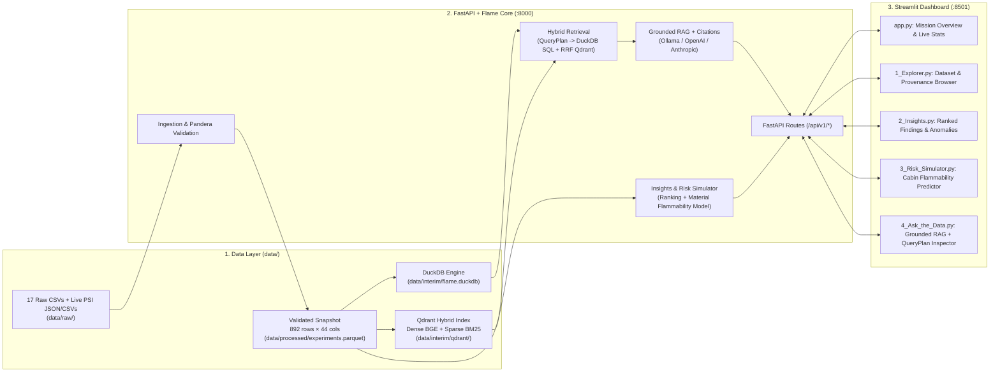

# Procedure: Harvesting `example_project` into Our Local Stack (Option 1)

This document lays out the step-by-step plan to harvest the datasets, ingestion pipeline, hybrid retrieval engine (DuckDB + Qdrant/FastEmbed), and grounded RAG API from `example_project/Flame-in-Freefall/`, integrate them with our live PSI fetcher (`scripts/fetch_psi_data.py`), and wire the entire backend into our pure-Python **Streamlit** dashboard.

---

## Architecture Overview

---

## Step-by-Step Execution Plan

### Phase 1: Harvest Datasets, Reports & Documentation
1. **Copy Raw Datasets (`data/raw/`):**
   - Copy all 17 curated raw CSV files from `example_project/Flame-in-Freefall/data/raw/*.csv` into `data/raw/`, while keeping the live PSI API outputs in `data/raw/psi/` fetched by `scripts/fetch_psi_data.py`.
2. **Copy Processed Snapshot & Provenance (`data/processed/` & `data/reports/`):**
   - Copy `canonical_experiments.csv`, `experiments.parquet` (892 rows × 44 columns), and `provenance_manifest.json` into `data/processed/`.
   - Copy `data/reports/quality_report.md` and `data/reports/canonical_diff.csv` into `data/reports/`.
3. **Copy Documentation & Golden Evaluation Set (`docs/` & `evaluation/`):**
   - Copy `docs/data_dictionary.md`, `docs/audit/repo_audit.md`, and `docs/decisions/*.md` into `docs/`.
   - Copy `evaluation/golden_questions.yaml` and `evaluation/expected_answers.yaml` into `evaluation/` so we have 65 benchmark questions ready to test and showcase in the UI.

---

### Phase 2: Harvest the `flame` Engine & Unify Backend Structure
1. **Import `src/flame/` Package:**
   - Copy `example_project/Flame-in-Freefall/src/flame/` into `src/flame/` (or expose it on `PYTHONPATH` alongside `backend/`):
     - `flame/config.py`: Typed `FLAME_*` settings (`pydantic-settings`).
     - `flame/schemas/`: `Experiment` (28 canonical + 16 provenance/quality columns), `QueryPlan`, and `AskResponse` contracts.
     - `flame/ingestion/`: Deterministic CSV cleaning, vocabulary mappings (`mappings/*.yaml`), specimen dimension extraction, and Pandera validation.
     - `flame/retrieval/`: `ExperimentStore` (DuckDB SQL compiler + catalog) and `semantic.py` / `fusion.py` (Qdrant dense `BAAI/bge-small-en-v1.5` + sparse `Qdrant/bm25` with Reciprocal Rank Fusion).
     - `flame/rag/` & `flame/llm/`: `QueryPlanner`, grounded `AnswerGenerator`, citation/numeric guardrails, and LLM clients (`OpenAICompatClient` for local Ollama / OpenAI / Gemini-compatible endpoints + `AnthropicClient`).
     - `flame/observability/`: Request ID correlation and secret-redacting JSON logger.
2. **Keep Our TLS/SSL Helper (`backend/app/core/http.py`):**
   - Preserve `backend/app/core/http.py` and `certs/sslcom-tls-issuing-rsa-r1.pem` so live NASA PSI / Space Apps fetches continue to pass strict SSL verification on Fedora.
3. **Extend the FastAPI Application (`backend/app/main.py` & `src/flame/api/routes.py`):**
   - Mount `flame.api.routes` (`/api/v1/health`, `/api/v1/ready`, `/api/v1/meta`, `/api/v1/experiments`, `/api/v1/experiments/{id}`, `/api/v1/ask`).
   - Add our two Space Apps decision-support endpoints on top of `ExperimentStore`:
     - `GET /api/v1/insights/ranking`: Ranks the 30 dataset families and 892 experiments by fire-safety criticality (oxygen sensitivity, low-velocity microgravity flame spread vs. 1g upward screening in `NASA-STD-6001`, extinction difficulty, and CO/soot hazard), plus links to the PSI repository metadata in `data/raw/psi/`.
     - `POST /api/v1/insights/risk`: Trains/runs a scikit-learn flammability & spread-rate predictor fitted on the 840 physical (non-modeled) rows in `experiments.parquet`, returning:
       - Predicted `burning_rate_mms` and `flame_temp_k`
       - Extinguishment outcome probability (`Sustained` vs `Self-Extinguished` / `Quenched`)
       - Closest real historical NASA/JAXA experiments (nearest neighbors in `(oxygen_pct, pressure_kpa, airflow_velocity_cms, fuel_material)` space with full citations).
4. **Local-First LLM & Deterministic Fallback Mode:**
   - Configure `OpenAICompatClient` to work out-of-the-box with local **Ollama** (`http://localhost:11434/v1`) or any API key in `.env`.
   - Add a **deterministic rule-based planner fallback** when no LLM is running locally, so `/api/v1/ask` still compiles `QueryPlan` queries, runs DuckDB + Qdrant hybrid retrieval, and returns grounded evidence tables and citations even offline without an LLM key.

---

### Phase 3: Install Missing Python Packages into `.venv` & Build Indexes
1. **Verify & Install Dependencies in `.venv` (Python 3.12):**
   - Check `.venv` for `duckdb`, `pyarrow`, `pandera`, `pyyaml`, `qdrant-client`, `fastembed`, `anthropic`, `scikit-learn`, `streamlit`, `plotly`, `fastapi`, `uvicorn`. Install any missing wheels into `.venv`.
2. **Build Local DuckDB & Qdrant Indexes:**
   - Copy `scripts/build_dataset.py` and `scripts/build_index.py` from `example_project`.
   - Run `python -m scripts.build_dataset` to verify `data/processed/experiments.parquet` and `data/reports/quality_report.md`.
   - Run `python -m scripts.build_index` to populate `data/interim/qdrant/` with hybrid dense + BM25 vectors for all 892 experiments.

---

### Phase 4: Build the 4 Interactive Streamlit Pages (`frontend/`)
Port the features from `example_project/Flame-in-Freefall/frontend/src/` (React) into our pure-Python Streamlit app (`frontend/`):

1. **`frontend/app.py` (Mission Control Home):**
   - Live readiness & status strip (`/api/v1/ready`, `/api/v1/meta`): 892 total experiments, 30 dataset families, 35 investigations, 840 physical vs. 52 modeled partial-g rows, 42 quarantined BASS-II airflow records.
   - Scientific Limitations Banner (`LimitationsBanner` from the React UI) explaining `is_modeled`, `AIRFLOW_QUARANTINED`, and cross-family `burning_rate_mms` semantics.
   - Overview charts: Experiments by Dataset Family, Gravity Regime breakdown, and Oxygen vs. Pressure envelope across ISS, Shuttle, Cygnus (Saffire), Kibo (FLARE), and GRC Drop Tower.
2. **`frontend/pages/1_Explorer.py` (Dataset & Provenance Explorer):**
   - Filters for Dataset Family (all 30 families), Fuel Material (112 materials), Gravity Condition, Oxygen %, Pressure (kPa), and a **Modeled Rows Toggle** (`include_modeled`, matching `ModeledToggle.tsx`).
   - Interactive Plotly scatter/distribution plots (e.g., Oxygen % vs. Burning Rate, Pressure vs. Flame Temp, Extinction Outcome breakdown).
   - Paginated experiment table + **Detail Inspector** (`DetailDrawer.tsx` equivalent) showing all 44 columns, raw vs. cleaned values, `data_quality_flags`, provenance (`source_file`, `source_row`, `record_source`), and live PSI documentation from `data/raw/psi/`.
3. **`frontend/pages/2_Insights.py` (Ranked Fire-Safety Findings & Anomaly Audit):**
   - **Ranked Fire-Safety Insights:** Top findings ranked by mission criticality (e.g., why materials passing 1g `NASA-STD-6001` burn in low-flow microgravity in `BASS`/`SOFIE`; cool-flame re-ignition in `FLEX-2`; large-scale cabin pressure/O2 response in `SAFFIRE I–VI`).
   - **Data Quality & Provenance Audit Viewer:** Interactive breakdown of the 42 `AIRFLOW_QUARANTINED` rows, 52 `is_modeled` partial-g rows, and 23 `TEST_DATE_CAMPAIGN_RANGE` rows.
4. **`frontend/pages/3_Risk_Simulator.py` (Moon/Mars Habitat Flammability Simulator):**
   - Preset buttons for **ISS Standard** (21% O2, 101.3 kPa), **Artemis / Lunar Exploration Atmosphere** (34% O2, 56.5 kPa), **Spacewalk Pre-breathe**, and **Custom Condition** sliders (`oxygen_pct`, `pressure_kpa`, `airflow_velocity_cms`, `fuel_material`).
   - Displays ML-predicted flammability risk score, expected burn rate & flame temperature, and a table of the **5 closest actual NASA/JAXA experiments** from DuckDB with their real outcomes.
5. **`frontend/pages/4_Ask_the_Data.py` (Grounded Hybrid RAG & QueryPlan Inspector):**
   - Quick-select dropdown of the 65 benchmark questions from `evaluation/golden_questions.yaml` + custom chat input.
   - Displays:
     - **Grounded Answer** with clickable experiment citations (`[BASS-001]`, `[SAF2-003]`, etc.)
     - **Compiled `QueryPlan` & SQL/Hybrid Inspector** (`PlanPanel.tsx` equivalent: shows intent, filters, aggregates, whether semantic RRF was triggered, and latency breakdown)
     - **Retrieved Evidence Table** (`EvidenceTable.tsx` equivalent: exact rows used to ground the answer).

---

### Phase 5: Verification & Local Launch
1. Run the migrated test suite (`pytest`) to verify ingestion, DuckDB query compilation, Qdrant hybrid search, and API endpoints (`/api/v1/*`).
2. Start both FastAPI (`:8000`) and Streamlit (`:8501`) via `scripts/run_local.sh` and verify every page end-to-end.
3. Clean up or archive `example_project/` once everything is verified (only if you ask).
